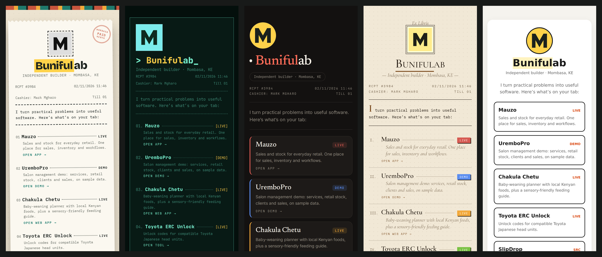
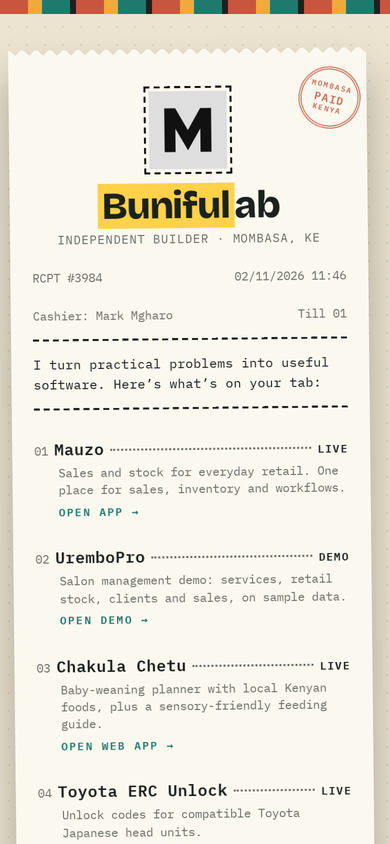
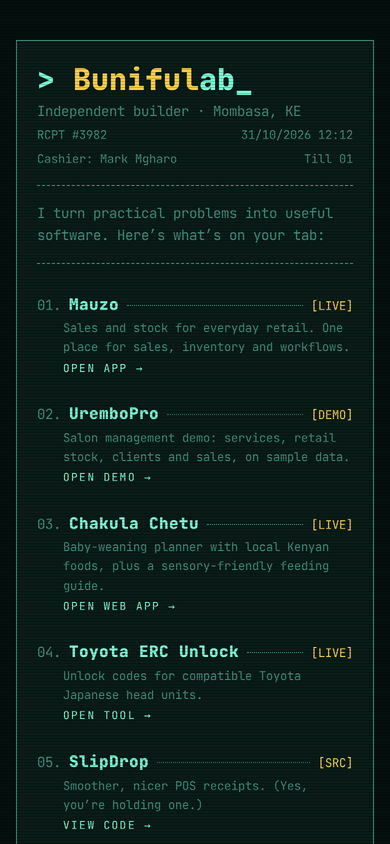
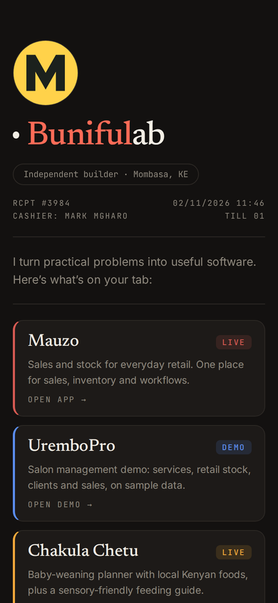
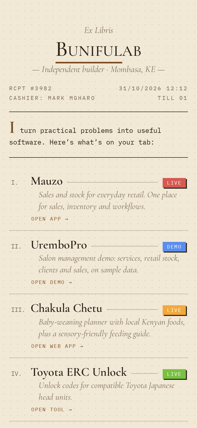
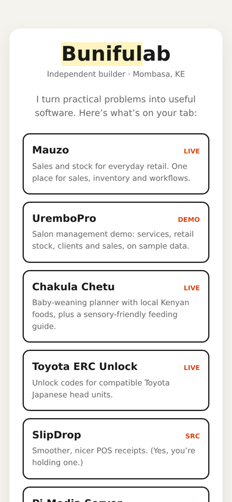
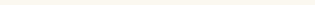

# Tawi

**Tawi** (Swahili for "branch") is a small, build-free link tree you can make your own. Plain HTML, CSS and JavaScript: no npm, no framework.
Content lives in one file, the look lives in swappable theme files. Built for freelancers, gig workers and small businesses.



## Themes

Same `config.js`, five looks. Switch with `theme:` in the config, or preview any of them with `?theme=name` on the URL.

<table>
  <tr>
    <td align="center"><br><b>receipt</b><br><sub>till slip, stamp, barcode</sub></td>
    <td align="center"><br><b>terminal</b><br><sub>teal on black</sub></td>
    <td align="center"><br><b>dark</b><br><sub>serif + colour-coded cards</sub></td>
    <td align="center"><br><b>library</b><br><sub>Ex Libris parchment</sub></td>
    <td align="center"><br><b>starter</b><br><sub>clean base to copy</sub></td>
  </tr>
</table>

The receipt theme also has a tear-off contact strip. Drag or tap it and a contact stub opens, which sends your message straight to WhatsApp:

<p align="center"></p>

Full-page captures: [receipt](docs/screenshots/receipt-full.png) · [terminal](docs/screenshots/terminal-full.png) · [dark](docs/screenshots/dark-full.png) · [library](docs/screenshots/library-full.png) · [starter](docs/screenshots/starter-full.png)

```
index.html      thin shell (edit the <title> and share-preview tags by hand)
config.js       ALL your content: name, links, socials, contact. Start here.
core.css        shared mechanics (animation, tear strip, form basics). Rarely edited.
app.js          builds the page from config.js. No need to edit.
themes/
  receipt.css   thermal till slip: torn paper, stamp, barcode
  terminal.css  teal on black, blinking cursor
  dark.css      warm near-black, serif headlines, rounded cards, colour-coded links
  library.css   "Ex Libris" parchment: small caps, roman numerals, ruled notice box
  starter.css   clean neutral base, fully commented. Copy this one.
```

## 1. Make it yours (5 minutes)
1. Open `config.js` and replace the name, links, socials and contact details.
2. Set `theme:` to `"receipt"`, `"terminal"`, `"dark"`, `"library"` or `"starter"`. Preview any of them with `?theme=terminal` on the URL.
3. Edit the `<title>` and `<meta>` tags in `index.html` so shared links look right.
4. Put the folder on GitHub and deploy (below).

## 2. Create your own theme
1. Copy `themes/starter.css` to `themes/mylook.css`.
2. Change the colour and font tokens at the top, then restyle the hooks (the list is at the top of that file).
3. Set `theme: "mylook"` in `config.js`.

Rules of thumb:
- Themes only restyle. They never need to touch `app.js` or `config.js`.
- Set the tokens `--bg --surface --ink --muted --accent --hl --slip --font-body --font-head` and the tear strip and contact form follow your palette automatically.
- Decorations (`.stamp`, `.bar`, `.deco-top`) are hidden by default. Show them with `display:block` if your design wants them.
- Hide what you don't need with `display:none` (for example `.meta`, `.sum`, `.total`).
- A link's `color` reaches your CSS as `var(--c)`. Fall back with `var(--c, var(--accent))`.
- Keep tap targets at least 44px high and test on a phone.

## 3. Config reference
| Key | What it does |
| --- | --- |
| `profile` | name, highlighted part of the name, owner, tagline, intro line |
| `links[]` | `title`, `url`, `desc`, `tag` (LIVE/DEMO…), `cta` (button text), `color` (optional accent used by the dark and library themes) |
| `summary[]`, `total` | optional stat rows; themes may hide them |
| `connect.socials[]` | buttons such as GitHub, TikTok, Instagram |
| `contact` | `whatsapp` (international format, no +), `email`, `dm` link, form wording |
| `themes[]`, `features.picker` | `picker: true` shows a theme switcher at the bottom (handy for demos, turn it off on a real page) |
| `features.tear` | `true` = tear-off strip reveals the form, `false` = form is just open |
| `stamp`, `meta`, `thanks`, `footer` | flavour text that themes can show or hide |

All config text is inserted as plain text, so characters like `<` or `&` are safe.

## 4. Deploy
- **Vercel / Netlify:** import the repo, no build command, output directory is the repo root.
- **GitHub Pages:** Settings > Pages > deploy from `main`, root.

## Notes
- Link previews (WhatsApp, X, etc.) read `index.html` only, so set the `og:` tags there.
- Themes load Google Fonts; swap the `@import` line for self-hosted fonts if you want zero third-party requests.
- Free to use and modify. Credit is appreciated, not required.
